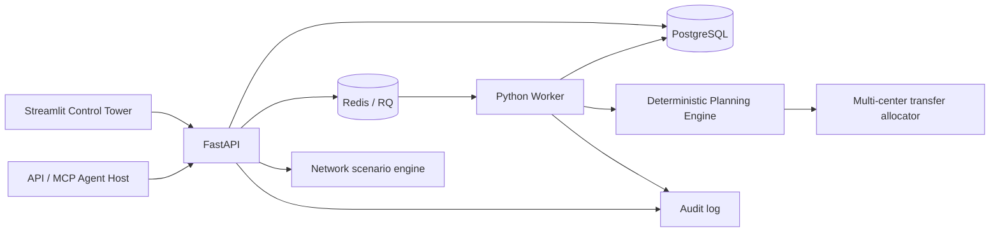

# SortFlow v2 architecture

## Event lifecycle

1. Client submits an event. An optional `Idempotency-Key` makes transport retries return the original event/workflow.
2. API persists the event, workflow, and audit records, then enqueues the workflow in Redis/RQ.
3. Worker atomically claims a workflow only if its state is `QUEUED`, records a start audit entry, and loads a network snapshot.
4. Deterministic planner calculates demand, effective capacity, labor gap, and a multi-destination transfer proposal.
5. Worker persists the result and terminal state and writes an audit record.
6. Dashboard and MCP tools read the same API; no MCP tool executes a real-world transfer.

## Reliability boundaries

- Idempotency is enforced for clients that consistently reuse the same key. It does not deduplicate semantically identical events sent with different keys.
- Conditional workflow claiming prevents two workers from claiming the same queued row. A process crash after claim can still leave a `RUNNING` workflow requiring operational recovery; a production design should add leases/heartbeats and a stale-job reconciler.
- The API currently commits the event before Redis enqueue. A production deployment should use a transactional outbox and a publisher/reconciler to close the database/queue dual-write gap.
- Audit logs are append-only by application convention, not cryptographically tamper-evident.
- The minimum-cost allocator is optimal for the simplified continuous model (linear unit costs and independent spare-capacity constraints), but it is not a full network-flow optimizer with route, time-window, package-mix, or labor constraints.

## Human-in-the-loop safety

All transfer plans are proposals. The response explicitly sets `human_approval_required=true` and `execution_performed=false`. A future execution adapter should require authorization, policy checks, idempotent commands, bounded quantities, and a separate approval record.
